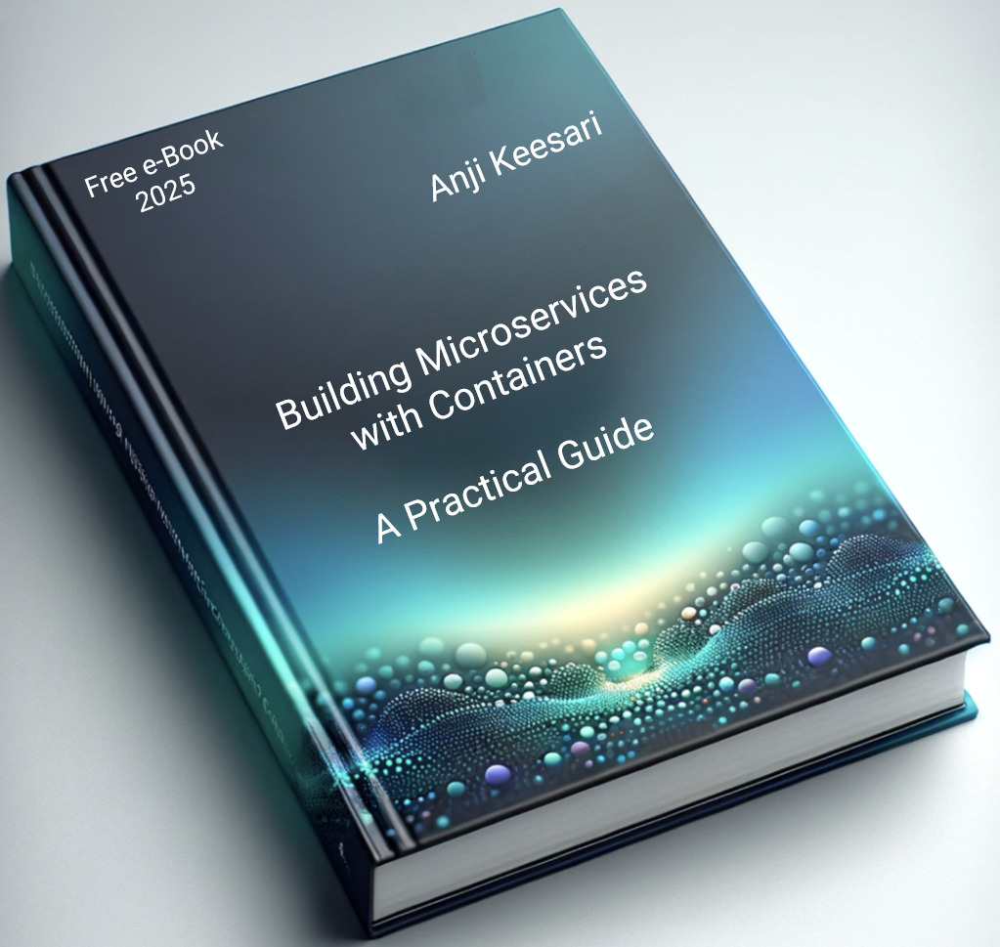

<p align="center">
  
</p>

<h1 align="center">Building Microservices with Containers</h1>
<h3 align="center">A Practical Guide</h3>

<p align="center">
  <a href="https://microservices.anjikeesari.com"><b>Read the book online</b></a> ·
  <a href="https://anjikeesari.com">Author</a> ·
  <a href="../../issues">Report an error</a>
</p>

<p align="center">
  <a href="https://github.com/akeesari/microservices/actions/workflows/ci.yml"></a>
  
</p>

A free, hands-on e-book that takes you from "what is a microservice?" to running real services in Docker containers. Every chapter is a lab: you build something, containerize it, and run it.

## Who is this for?

- Developers who build apps with .NET, Node.js or React and want to containerize them.
- Engineers moving from monoliths to microservices.
- Anyone preparing to deploy to Kubernetes who needs solid container fundamentals first.

You don't need prior Docker experience. Basic command-line and Git familiarity helps.

## What you'll learn

| # | Chapter | You will |
|---|---------|----------|
| 1 | Getting Started with Microservices | Learn the architecture, trade-offs, communication styles and DDD basics |
| 2 | Docker Fundamentals | Understand images, containers, registries and orchestration |
| 3 | Getting Started with Docker | Install Docker and use the core commands |
| 4 | Containerize a .NET Core Web API | Build, Dockerize and publish a REST API |
| 5 | Containerize a Node.js API | Do the same with Node.js |
| 6 | Containerize a .NET Core MVC App | Package a web front end |
| 7 | Containerize a React.js App | Package a single-page app |
| 8 | SQL Server in a container | Run and seed a database |
| 9 | PostgreSQL in a container | Run and seed a second database |
| 10 | Keycloak in a container | Add identity and access management |
| 11 | Drupal in a container | Run a CMS with its database |
| A | Cheat sheets | Git, Docker and Dockerfile quick references |

## Prerequisites

- Docker Desktop
- Git and VS Code
- .NET SDK, Node.js (for the matching chapters)
- An Azure account (Azure DevOps and Azure Container Registry) for the publishing steps

## Runnable samples

[`samples/`](samples) has a tested reference for every lab (.NET 10, Node 24, React 19 with Vite, SQL Server, PostgreSQL, Keycloak, Drupal). Use it to compare against your own work. Build and run commands are in [samples/README.md](samples/README.md).

## Run the site locally

```bash
git clone https://github.com/akeesari/microservices.git
cd microservices
pip install -r requirements.txt
mkdocs serve
```

Then open <http://127.0.0.1:8000/>. To check for broken links before pushing: `mkdocs build --strict`.

## Repository layout

```
docs/            Book content (Markdown), images, theme overrides
  introduction/  Author, acknowledgments, introduction, table of contents
  microservices/ Chapters 1-11 and their images
  appendix/      Cheat sheets
samples/         Tested, runnable Dockerfiles and compose files for chapters 4-11
mkdocs.yml       Site configuration and navigation
.github/         CI: strict build on PRs, deploy to GitHub Pages on main
CLAUDE.md        Guidance for AI-assisted editing of this repo
```

## About the author

**Anji Keesari** is a software engineer and cloud architect with 20+ years of experience in cloud, containers, Kubernetes and Terraform, and a passion for teaching. Find more articles, tutorials and contact details at **[anjikeesari.com](https://anjikeesari.com)**.

## Feedback

Found a typo or an outdated command? Please [open an issue](../../issues/new/choose). See [CONTRIBUTING.md](CONTRIBUTING.md).

## License

Copyright © 2023-2026 Anji Keesari. **All rights reserved.** The book content, code samples, images and site source may not be copied, republished, redistributed, or used to train AI models without written permission. See [LICENSE](LICENSE). To request permission, email anjkeesari@gmail.com.
