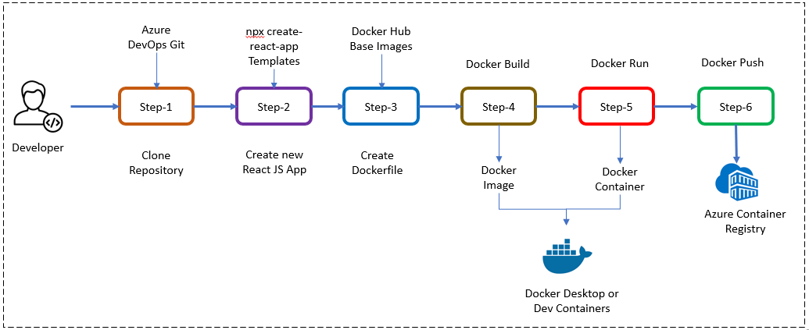
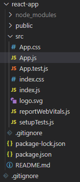
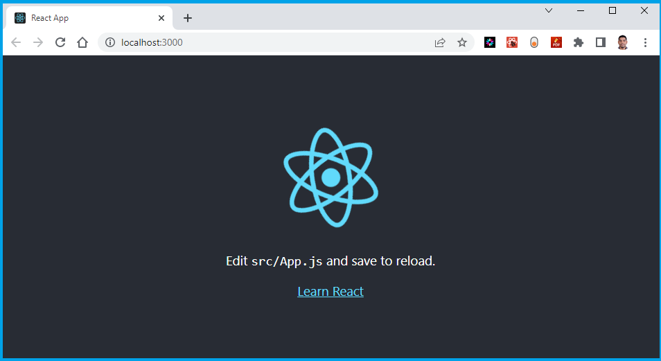
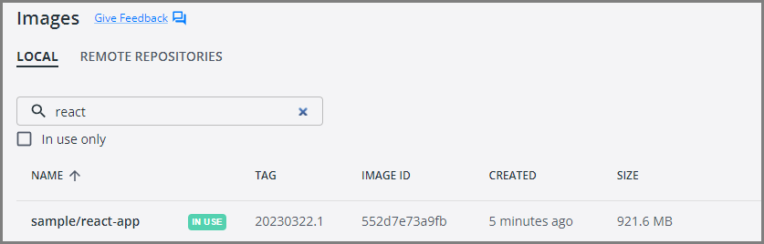
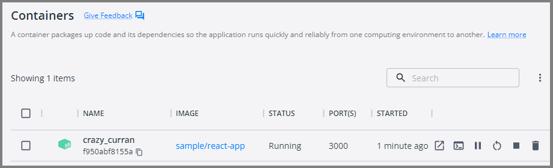

# Chapter-7: Create Your Second Website using React.js

## Introduction

In this lab, we will create our second website using React.js, which serves as another MicroFrontend application in our Microservices architecture.

Our goal is to prepare a React.js application for deployment on Kubernetes. The UI applications developed in this lab will be utilized in subsequent labs, including the creation of DevOps pipelines and the deployment to Azure Kubernetes Service.

Let's look into the lab and begin our journey by creating a React.js application as part of the Microservices Architecture!

## Technical Scenario

As a `Frontend (FE)` developer, you have been assigned the task of developing a website or UI application using React.js technology. This website will be one of the small Website (UI) components in our MicroFrontend applications list.

This lab aims to provide you with hands-on experience in creating a React.js application as part of the Microservices Architecture. We will begin by utilizing an existing Git repository and proceed to create a new React.js project within it. Finally, we will containerize this website and push it to the Azure Container Registry (ACR) in preparation for deployment to Azure Kubernetes Service (AKS).

## Objective

In this exercise, our objective is to accomplish and learn the following tasks:

- **Step-1:** Install Node.js and NPM
- **Step-2:** Create new React.js application
- **Step-3:** Add Dockerfiles to the React.js project
- **Step-4:** Docker Build locally
- **Step-5:** Docker Run locally
- **Step-6:** Publish docker container to ACR

## Prerequisites

- Git Repository
- Clone existing Microservices repo
- Download and install software for React Development 
- Docker Desktop
- VS Code with Docker extension
- Azure Container Registry (ACR)

## Architecture Diagram

The following diagram shows the high level steps to create the website using React.js.

[](images/image-11.png){:target="_blank"}

## Step-1: Install Node.js and NPM

!!! note
    Screenshots and sample output in this chapter were captured with an earlier setup and may differ slightly from what you see with current tool versions.

Before you can create a React app, you'll need to install Node.js and NPM (Node Package Manager) on your system. You can download the LTS installer of Node.js and NPM from the official website: <https://nodejs.org/en/download/>

**Manual install**

Click on the Installer as per your Operating system preference to install Node.js & NPM both in your system.

**install using commands**

- **Windows OS**

Install Node.js & NPM using Chocolatey (choco) for Windows users, assuming you already installed choco in your system, run these commands as administrator from command prompt

``` sh
# This command will download and install the current LTS version of Node.js.
choco install nodejs-lts
```

- **Mac OS**

Install Node.js & NPM using Homebrew for Mac users, assuming you already installed Homebrew in your system:

```sh
# install the latest version
brew install node
```

verify that Node.js is installed correctly

``` sh
node --version
```
output

``` sh
v19.8.1
```
verify that npm version is installed correctly

``` sh
npm version
```
output
``` sh
{
  npm: '9.5.1',
  node: '19.8.1',
  acorn: '8.8.2',
  ada: '1.0.4',
  ares: '1.19.0',
  brotli: '1.0.9',
  cldr: '42.0',
  icu: '72.1',
  llhttp: '8.1.0',
  modules: '111',
  napi: '8',
  nghttp2: '1.52.0',
  nghttp3: '0.7.0',
  ngtcp2: '0.8.1',
  openssl: '3.0.8+quic',
  simdutf: '3.2.2',
  tz: '2022g',
  undici: '5.21.0',
  unicode: '15.0',
  uv: '1.44.2',
  uvwasi: '0.0.16',
  v8: '10.8.168.25-node.12',
  zlib: '1.2.13'
}
```
## Step-2: Create a new React.js application

Once you have Node.js installed, you can create a new React.js application using Vite. The older `create-react-app` tool is deprecated, so we use the Vite React template instead. Open a terminal window and run the following command:

``` sh
npm create vite@latest react-app -- --template react
```

This command will create a new React.js application with all the necessary files and directories in a folder named `react-app` in your current directory. If Vite asks any questions, accept the defaults.

[](images/image-20.jpg){:target="_blank"}

**Run the Application**

``` sh
cd react-app
npm install
npm run dev
```

The Vite dev server starts on <http://localhost:5173>. Open it in your browser to see the running application.

[](images/image-21.jpg){:target="_blank"}


## Step-3: Add Dockerfiles to the React.js project

Create a Dockerfile in the root directory of your project and copy following code. Dockerfile will provide instructions for building a container image of our React.js Website.

``` Dockerfile
# Build stage: compile the static site with Vite
FROM node:24-alpine AS build
WORKDIR /app
COPY package.json package-lock.json ./
RUN npm ci
COPY . .
RUN npm run build

# Serve stage: static files served by nginx
FROM nginx:alpine AS final
COPY --from=build /app/dist /usr/share/nginx/html
EXPOSE 80
```

Create a `.dockerignore` file next to the Dockerfile so local `node_modules` and `dist` folders are not copied into the build context:

``` text
node_modules
dist
```

This is a multi-stage Dockerfile. The first stage uses Node.js to install dependencies (`npm ci`) and build the static files (`npm run build`) into `/app/dist`. The second stage copies only those static files into an `nginx:alpine` image, which serves them on port 80. The final image contains no Node.js or source code, so it is small, and no development server runs in the container.

!!! Note
    Read inline comments of the Dockerfile for understanding the Dockerfile instructions

## Step-4: Docker Build locally

We will build the Docker container locally using the Dockerfiles and ensure that the containerized application functions as expected.

The `docker build` command is used to build Docker images from a Dockerfile.  

``` sh
docker build -t sample/react-app:20230322.1 .
```

Docker runs both stages (installing dependencies and building the site, then copying the result into the nginx image) and finishes by naming the image `sample/react-app:20230322.1`.

When you run the `docker build` command, Docker looks for a Dockerfile in the specified directory (PATH) and reads the instructions in the file to build a new image. 

The Dockerfile contains a series of instructions that define how to build the image, such as copying files, running commands, and setting environment variables. 

## Step-5: Docker Run locally

Run the Docker container locally to verify that the application functions correctly within a containerized environment. This step ensures that the containerized application operates as expected on your local machine.

Run the `docker run` command to start a container based on the image:

``` sh
docker run --rm -p 8080:80 sample/react-app:20230322.1
```
The nginx container starts and waits for requests, so the terminal shows no application output until you open the site in your browser.

if you open Docker Desktop you will notice the new image & container started running.

**Image**

[](images/image-22.jpg){:target="_blank"}


**Container**

[](images/image-23.jpg){:target="_blank"}

This will start the React.js application in the Docker container and map the container's port 80 (nginx) to your local machine's port 8080. 

Your React.js application is now running inside a Docker container.

Open your favorite browser and enter the following URL to see the running application in port 8080

<http://localhost:8080/>


[](images/image-21.jpg){:target="_blank"}


You now have a basic React.js application up and running. From here, you can continue building out your application by adding more and more code as per your requirements.

## Step-6: Push docker container to ACR

Now we've Docker Containers ready locally for push to Container Registry so that we can use them in future deployment to Azure Kubernetes Service (AKS). This step prepares the container for deployment to the cloud environment.

To publish a Docker container to Azure Container Registry (ACR), you will need to have the following:

1. Create an Azure Container Registry. If you don't have one, you can create one by following the instructions in the Azure Portal or using Azure CLI.
1. Log in to your Azure Container Registry using the Docker command-line interface. You can do this by running the following command:
    ```sh
    # azure Login
    az login

    # set the azure subscription
    az account set -s "anji.keesari"

    # Log in to the container registry
    az acr login --name acr1dev
    # Login Succeeded
    # To get the login server address for verification
    az acr list --resource-group rg-acr-dev --query "[].{acrLoginServer:loginServer}" --output table

    # output should look similar to this.

    # AcrLoginServer    
    # ------------------
    # acr1dev.azurecr.io
    ```
    list all the Docker images that are available on the local system

    ```sh
    docker images
    ```

    output

    ```text
    REPOSITORY                                                TAG                                                                          IMAGE ID       CREATED         SIZE
    sample/aspnet-app                                         20230312.1                                                                   587f347206bc   8 minutes ago   216MB
    .
    .
    .
    ```

1. `Tag` your Docker container image with the full name of your Azure Container Registry, including the repository name and the version tag. You can do this by running the following command:

    ```sh
    docker tag sample/react-app:20230322.1 acr1dev.azurecr.io/sample/react-app:20230322.1
    ```

1. Push your Docker container image to your Azure Container Registry using the Docker command-line interface. You can do this by running the following command:

    ```sh
    docker push acr1dev.azurecr.io/sample/react-app:20230322.1
    ```

    Output

    ```sh
    The push refers to repository [acr1dev.azurecr.io/sample/react-app]
    649a035a1734: Pushed
    4061bd2dd536: Pushed
    c0257b3030b0: Pushed
    912a3b0fc587: Pushed
    a36186d93e25: Pushed
    a3d997b065bc: Pushed
    65d358b7de11: Pushed
    f97384e8ccbc: Pushed
    d56e5e720148: Pushed
    beee9f30bc1f: Pushed
    20230322.1: digest: sha256:73f0669d18c6cae79beb81edc8c523191710f9ec4781d590884b46326f9ad6f9 size: 2419
    ```

1. Wait for the push to complete. Depending on the size of your Docker container image and the speed of your internet connection, this may take a few minutes.
1. Verify the newly pushed image to ACR.

    ```sh
    az acr repository list --name acr1dev --output table
    ```

    Output

    ```text
    Result
    -------------------------------
    mcr.microsoft.com/dotnet/aspnet
    mcr.microsoft.com/dotnet/sdk
    sample/aspnet-api
    sample/aspnet-app
    sample/react-app
    ```

1. Show the new tags of an image in the ACR

    ```sh
    az acr repository show-tags --name acr1dev --repository sample/react-app --output table
    ```

    output

    ```text
    Result
    ----------
    20230322.1
    ```

You've successfully pushed your Docker container image to Azure Container Registry. You can now use the Azure Portal or Azure CLI to manage your container images and deploy them to Azure services like Azure Kubernetes Service (AKS).

